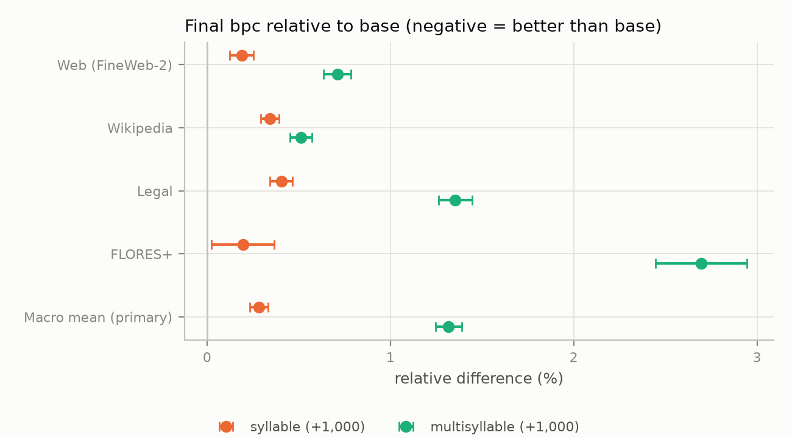
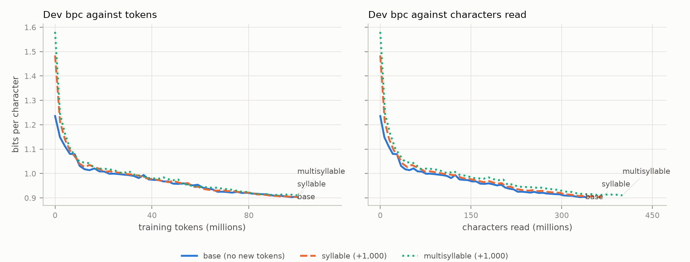
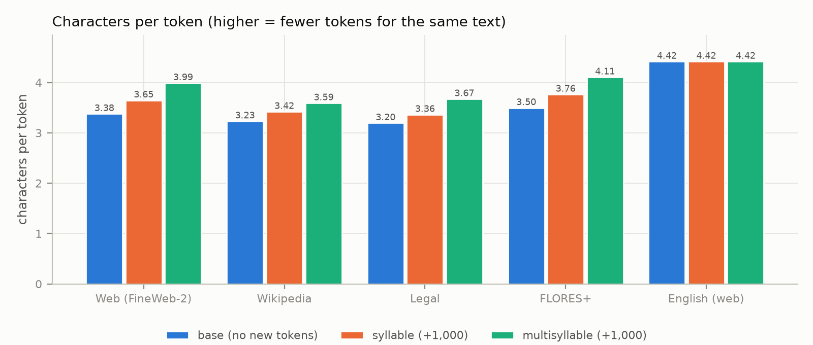

<div align="center">

# nanovitok

[](https://github.com/geminitt/nanovitok/actions/workflows/ci.yml)
[](./pixi.toml)
[](https://modal.com)
[](./LICENSE)

**Which added Vietnamese tokens does Qwen3-0.6B learn best from under continued pretraining?**

</div>

---

## Question

We add 1,000 Vietnamese tokens to the tokenizer of Qwen3-0.6B and continue its pretraining on Vietnamese text with
all parameters trainable. Two token types are compared with an unchanged tokenizer:

| Condition | New tokens | Example |
|---|---|---|
| base | none | — |
| syllable | 1,000 merges inside a syllable (never across a space) | ` the` + `o` → ` theo` |
| multisyllable | 1,000 merges that may also cross a space | ` có` + ` thể` → ` có thể` |

The new tokens come from continued BPE merges on held-out FineWeb-2 text; existing token ids do not change. Each new
embedding row starts as the mean of the rows of its pieces (input and output embeddings are tied).

**Answer (one seed).** At the same number of training tokens, base has the lowest bits per character on all four
Vietnamese test domains. The syllable model is 0.28% worse and the multisyllable model 1.32% worse (macro mean;
95% intervals exclude zero). The multisyllable model reads about 18% more text per token and generates about 11%
more characters per second.

---

## Design

| Item | Fixed protocol |
|---|---|
| Source model | [Qwen3-0.6B](https://huggingface.co/Qwen/Qwen3-0.6B), revision c1899de289a04d12100db370d81485cdf75e47ca |
| Number of new tokens | 1,000, chosen by a 40-step probe over 1,000 and 4,000 (rule fixed before the probe) |
| Training | 1,526 steps × 64 × 1,024 = 100,007,936 tokens per condition; all parameters; existing embedding rows frozen |
| Optimizer | AdamW (0.9, 0.95), weight decay 0.1, lr 1e-4 (best of 1e-5, 3e-5, 1e-4 for each condition), warmup 30, cosine to 10%, bf16 |
| Data | One FineWeb-2 Vietnamese stream (seed 0, 522.7 M characters), the same order for every condition; every held-out text removed |
| Quality metric | Bits per NFC character of the canonical tokenization, per document |
| Test sets | 1,000 FineWeb-2 test documents, 1,000 Wikipedia articles, 1,000 legal documents, 1,012 FLORES+ sentences; 1,000 English FineWeb documents |
| Primary comparison | Macro mean over the four Vietnamese domains of the relative bpc difference; paired bootstrap stratified by domain, 10,000 resamples, 95% interval |
| Decision rule | A beats B when the interval excludes zero in A's favor |
| Benchmarks | Belebele, Global-MMLU, XNLI, Okapi ARC and HellaSwag (Vietnamese), HellaSwag (English); a benchmark counts only if the original model is above chance (95% lower bound) |

Bits per character (bpc) is the negative log-likelihood of a document's text in bits, divided by its number of
NFC characters. It does not depend on the tokenizer, so models with different vocabularies compare on the same text.
Evaluation ran in fp16 on one A100. In a check on 16 documents, fp16 per-document scores differed from fp32 by at
most 2.7e-4 (relative); bf16 differed by up to 2.5e-3, so bf16 was not used for scoring.

---

## Results



Every domain shows the same order: base, then syllable, then multisyllable. The largest gaps are on FLORES+
(translated, formal sentences) and legal text. Error bars resample test documents; they do not cover run-to-run
training variation (one training seed).



Before training, the new embeddings make the extended models much worse. Most of that gap closes within the first
10% of training. After the middle of training the multisyllable gap stays at about +1.3% and does not shrink; the
syllable gap stays within ±0.4%. Per-domain curves at every saved checkpoint:
[domain_curves.png](./results/token-type/domain_curves.png).



English text is tokenized exactly as before.

### Checks on other abilities

| Condition (final) | English bpc vs original Qwen3 | 95% interval |
|---|---:|---|
| base | −1.70% | [−1.85%, −1.56%] |
| syllable | −1.45% | [−1.60%, −1.31%] |
| multisyllable | −1.17% | [−1.32%, −1.02%] |

Continued Vietnamese pretraining did not degrade English bpc in any condition.

| Benchmark (accuracy) | Original | base | syllable | multisyllable |
|---|---:|---:|---:|---:|
| Belebele (vi) | 34.8% | 36.1% | 36.8% | 37.1% |
| Global-MMLU (vi) | 28.0% | 27.5% | 27.5% | 27.3% |
| XNLI (vi) | 41.9% | 42.2% | 41.9% | 42.4% |
| Okapi HellaSwag (vi) | 35.6% | 38.2% | 37.4% | 37.5% |
| HellaSwag (en) | 47.4% | 45.3% | 44.8% | 45.2% |

Okapi ARC is excluded: the original model is not above chance on it. Differences between the trained models are
about one point. With a Bonferroni correction over the 10 McNemar tests against base, only syllable on Okapi
HellaSwag differs (worse, p = 0.003).

### Generation

Greedy decoding, 20 prompts, 256 new tokens, fp16, batch 1, one A100.

| Model (final) | Decode chars/s | Decode tokens/s | Chars per generated token | Repeated 4-syllable windows |
|---|---:|---:|---:|---:|
| base | 108.4 | 31.2 | 3.46 | 71.3% |
| syllable | 115.3 | 31.2 | 3.68 | 74.1% |
| multisyllable | 120.6 | 30.6 | 3.92 | 74.5% |

Tokens per second hardly change, so longer tokens give more characters per second. The models generate different
text, and greedy continuations repeat often, so these rates do not measure equally useful output.

### Limitations

- One training seed. A second seed would only reorder documents; it was not run.
- lr 1e-4 was the largest rate in the probe grid for all three conditions; a larger rate was not tested.
- 100 M training tokens. Whether a longer run closes the multisyllable gap is not tested.
- Training bpc (in the [report](./results/token-type/report.md) data) is measured on different text per condition
  and is not a paired comparison.

All numbers: [results/token-type/report.md](./results/token-type/report.md) and
[results.json](./results/token-type/results.json).

---

## Reproduce

The analysis regenerates from the committed item-level measurements (`results/token-type/data/`: every document,
item and generation of the 33 evaluated models, the training and dev logs). The test suite checks that the committed
results, tables and figures are reproduced byte for byte.

```bash
pixi install
pixi run python -m vitok.cpt_report --eval results/token-type/data/eval --train results/token-type/data/train \
    --evalsets results/token-type/data --snapshot-steps 153 305 458 610 763 916 1068 1221 1373 \
    --out results/token-type
pixi run python -m vitok.cpt_figures --results results/token-type/results.json --out results/token-type
```

To rerun the experiment (data from pinned Hugging Face revisions; FLORES+ is gated, accept its terms first):

```bash
pixi run python -m vitok.evalsets --out runs/evalsets          # held-out sets, merge text, dev set
hf download Qwen/Qwen3-0.6B tokenizer.json --revision c1899de289a04d12100db370d81485cdf75e47ca --local-dir qwen3
for kind in single multi; do                                      # syllable and multisyllable tokenizers
  pixi run python -m vitok.retrofit --base qwen3/tokenizer.json --corpus runs/evalsets/merge.jsonl \
      --kind $kind --n-new 1000 --out runs/tokenizers/$kind-1000
done
pixi run python -m vitok.stream --evalsets runs/evalsets --seed 0 --max-chars 520000000 \
    --part-chars 200000000 --out runs/stream-0                    # training text, held-out texts removed
```

Training and evaluation run on Modal ([remote/modal_app.py](./remote/modal_app.py)). Upload the tokenizers, dev set
and stream to the volume at the paths in [full-runs.json](./results/token-type/config/full-runs.json) and the
evaluation sets at the paths in [evaluation-plan.json](./results/token-type/config/evaluation-plan.json), then:

```bash
modal run --detach remote/modal_app.py::full --config /vol/full/config.json --conditions base --approved-max-usd 7
modal run --detach remote/modal_app.py::eval_full --plan /vol/eval/plan.json \
    --jobs "$(cat results/token-type/config/jobs-full.txt)" --approved-max-usd 3
modal run --detach remote/modal_app.py::eval_curve --plan /vol/eval/plan.json \
    --jobs "$(cat results/token-type/config/jobs-curve.txt)" --approved-max-usd 3
```

Each job refuses to start unless `--approved-max-usd` covers its timeout at Modal's listed rates. Training resumes
from its last checkpoint and scoring resumes item by item when a command is rerun. Measured on 2026-10-13: one full
run took 8,140–8,536 s on an A100-40GB; the six full evaluations took about 1,190 s per model.

---

## Earlier experiments

- **Small-budget retrofit** ([report](./results/adaptation.md)): the same token types with only four transformer
  layers and the new embedding rows trainable, 19.7 M tokens, fp16 on Kaggle T4. It is superseded by the
  experiment above. Its `multisyllable-1000-s1` run is a replicate of `multisyllable-1000` (same data order and
  initialization), not a second seed.
- **From-scratch NFC pilot** ([summary](./results/summary.md)): BPE against SuperBPE for small Vietnamese models
  trained from scratch with nanochat; tokenization-only evidence under a different design.

```bash
pixi run python -m vitok.report --data results/adaptation --out results/adaptation.md --figures figures
git clone https://github.com/karpathy/nanochat third_party/nanochat
git -C third_party/nanochat checkout $(cat patches/NANOCHAT_COMMIT)
git -C third_party/nanochat apply ../../patches/nanochat.patch
pixi run python -m vitok.analysis --results kaggle/outputs \
    --compression kaggle/outputs/vitok-data/compression-16k.json \
    --val-results results/val --out results/summary.md --figures figures
```

---

## Sources and license

- [Qwen3](https://huggingface.co/Qwen/Qwen3-0.6B): source model and tokenizer.
- [FineWeb-2](https://huggingface.co/datasets/HuggingFaceFW/fineweb-2) (ODC-By 1.0): Vietnamese training, merge,
  dev and test text. [FineWeb](https://huggingface.co/datasets/HuggingFaceFW/fineweb): English test text.
- [Wikipedia](https://huggingface.co/datasets/wikimedia/wikipedia) (20231101.vi),
  [Vietnamese legal documents](https://huggingface.co/datasets/th1nhng0/vietnamese-legal-documents),
  [FLORES+](https://huggingface.co/datasets/openlanguagedata/flores_plus): test domains.
- [Belebele](https://huggingface.co/datasets/facebook/belebele),
  [Global-MMLU](https://huggingface.co/datasets/CohereLabs/Global-MMLU),
  [XNLI](https://huggingface.co/datasets/facebook/xnli),
  [Okapi ARC](https://huggingface.co/datasets/alexandrainst/m_arc) and
  [HellaSwag](https://huggingface.co/datasets/alexandrainst/m_hellaswag),
  [HellaSwag](https://huggingface.co/datasets/Rowan/hellaswag): benchmarks.
- [SuperBPE](https://arxiv.org/abs/2503.13423): cross-whitespace BPE merges.
- [nanochat](https://github.com/karpathy/nanochat): the from-scratch pilot, pinned and patched under patches/.

Code is [MIT licensed](./LICENSE). Datasets and model weights keep their own licenses.
